# 🤖 Ai Agent Tools — Telegram Control untuk Termux

> Bot Telegram serba-bisa yang berjalan di **HP Android (Termux)** dalam **satu file Bash**.
> Dikendalikan lewat chat Telegram: AI chat (Gemini), NAS pribadi, pencarian internet, unduh YouTube / TikTok / Instagram, pemutar lagu, kompres file, pengingat, pemantauan HP server, dan kendali Termux dari jarak jauh.

**Versi script:** `Lokal 792` · **Bahasa:** Bash + Python (embedded) · **Platform:** Android + Termux
**Dibuat oleh:** Moh Hilmi Mulia R. · **Tim:** MP (Minions Project)

---

## 📑 Daftar Isi

1. [Ringkasan Fitur](#-ringkasan-fitur)
2. [Cara Kerja](#-cara-kerja)
3. [Persyaratan](#-persyaratan)
4. [Instalasi Lengkap dari 0 sampai 100%](#-instalasi-lengkap-dari-0-sampai-100)
5. [Konfigurasi](#-konfigurasi)
6. [Menjalankan, Menjaga, dan Memperbarui Bot](#-menjalankan-menjaga-dan-memperbarui-bot)
7. [Daftar Perintah](#-daftar-perintah)
8. [Penjelasan Fitur Lengkap](#-penjelasan-fitur-lengkap)
9. [Fitur Khusus Pemilik](#-fitur-khusus-pemilik)
10. [Batas Ukuran, Durasi, dan Waktu](#-batas-ukuran-durasi-dan-waktu)
11. [File yang Dibuat Bot](#-file-yang-dibuat-bot)
12. [Keamanan](#-keamanan)
13. [Pemecahan Masalah](#-pemecahan-masalah)
14. [Struktur Script](#-struktur-script)
15. [Kredit](#-kredit)
16. [Lisensi](#-lisensi)

---

## ✨ Ringkasan Fitur

| Kategori | Fitur |
|---|---|
| 🤖 **AI** | Chat dengan Google Gemini, ingatan percakapan per chat, komentar foto/video, baca dokumen (PDF, Word, Excel, PowerPoint, CSV, teks, dll.), OCR PDF hasil scan |
| 🔎 **Internet** | Pencarian DuckDuckGo otomatis, membaca isi halaman sumber, prioritas sumber resmi/terpercaya, verifikasi foto barang, link Tokopedia/Shopee untuk harga |
| 💾 **NAS pribadi** | Simpan foto/video/dokumen per tanggal, per pengguna (terpisah), cari, ambil, hapus, indeks isi file |
| 🎬 **YouTube** | `yt` (ringkasan AI), `ytraw` (transkrip), `ytdl` (unduh MP4/MP3), `play` (putar lagu) |
| 🎵 **Musik** | `play` (video + pemutar audio), `spotify` (hasil bertombol + Mini App kartu, playlist, lirik) |
| 📥 **Downloader** | TikTok tanpa watermark, Instagram (post/reel/carousel/story), YouTube MP4/MP3 |
| 🗜️ **Kompres** | Kompres video/foto/PDF/Office/audio ke ukuran target |
| ⏰ **Produktivitas** | Pengingat & timer (diulang sampai dibalas), catatan cepat, info terjadwal dari internet |
| 🎨 **Hiburan** | Stiker teks, game Tic Tac Toe (Mini App) lawan bot atau teman |
| 🛡️ **Monitoring** | Laporan harian, peringatan Cloudflare tunnel / SSH / baterai / disk, status RAM-suhu-WiFi |
| 👑 **Admin (pemilik)** | Kelola pengguna, blokir ID, update script via Telegram (rollback otomatis), kendali Termux, foto kamera HP, lihat/hapus NAS semua ID, riwayat pengunjung ke Excel |

---

## 🧠 Cara Kerja

Script berjalan sebagai **loop polling** (default tiap 3 detik) ke API Telegram. Tiap putaran, bot mengambil pesan baru, memeriksa whitelist, menjalankan fitur yang sesuai, lalu menjalankan pengecekan berkala (pengingat, laporan, monitor).

Bagian ini dibuat **berlapis (14 diagram, Level 0–13)**: mulai dari gambaran besar (Level 0), lalu makin rinci. Baca berurutan, atau langsung loncat ke bagian yang kamu butuhkan.

| Level | Diagram | Menjawab pertanyaan |
|---|---|---|
| 0 | [Gambaran besar](#level-0--gambaran-besar) | Apa saja bagian sistem ini dan siapa bicara dengan siapa? |
| 1 | [Perjalanan satu pesan](#level-1--perjalanan-satu-pesan) | Apa yang terjadi sejak pesan masuk sampai balasan terkirim? |
| 2 | [Siklus loop utama](#level-2--siklus-loop-utama) | Apa yang dikerjakan bot di tiap putaran? |
| 3 | [Akses dan whitelist](#level-3--akses-dan-whitelist) | Bagaimana ID dinilai: pemilik, terdaftar, terkunci, diblokir? |
| 4 | [Otak AI dan penanda](#level-4--otak-ai-dan-penanda) | Bagaimana Gemini "menyuruh" script melakukan sesuatu? |
| 5 | [Unduh, musik, dan kompres](#level-5--unduh-musik-dan-kompres) | Bagaimana media diambil, diproses, dan dikirim? |
| 6 | [Mini App](#level-6--mini-app-spotify-dan-game) | Bagaimana Spotify/Tic Tac Toe tampil di Telegram? |
| 7 | [Update script dan rollback](#level-7--update-script-dan-rollback) | Bagaimana script diperbarui dari Telegram dengan aman? |
| 8 | [Data di penyimpanan](#level-8--data-di-penyimpanan) | Data apa disimpan, di mana? |
| 9 | [Pengingat dan info terjadwal](#level-9--pengingat-dan-info-terjadwal) | Bagaimana pengingat diulang sampai dibalas? |
| 10 | [NAS dan indeks](#level-10--nas-dan-indeks-pencarian) | Bagaimana file disimpan, dicari, dan dihapus? |
| 11 | [Monitor dan laporan harian](#level-11--monitor-dan-laporan-harian) | Kapan pemilik dikabari soal kondisi HP? |
| 12 | [Dokumen dan OCR](#level-12--dokumen-dan-ocr-pdf) | Bagaimana dokumen dan PDF scan dibaca? |
| 13 | [Mulai otomatis dan watchdog](#level-13--mulai-otomatis-dan-watchdog) | Bagaimana bot hidup sendiri setelah HP menyala atau bot mati? |

### Level 0 — Gambaran besar

Tiga lapisan: **Telegram** (antarmuka), **HP Android** (otak + penyimpanan), dan **layanan internet** (sumber data). Tidak ada server sewaan: semuanya berjalan di HP-mu.

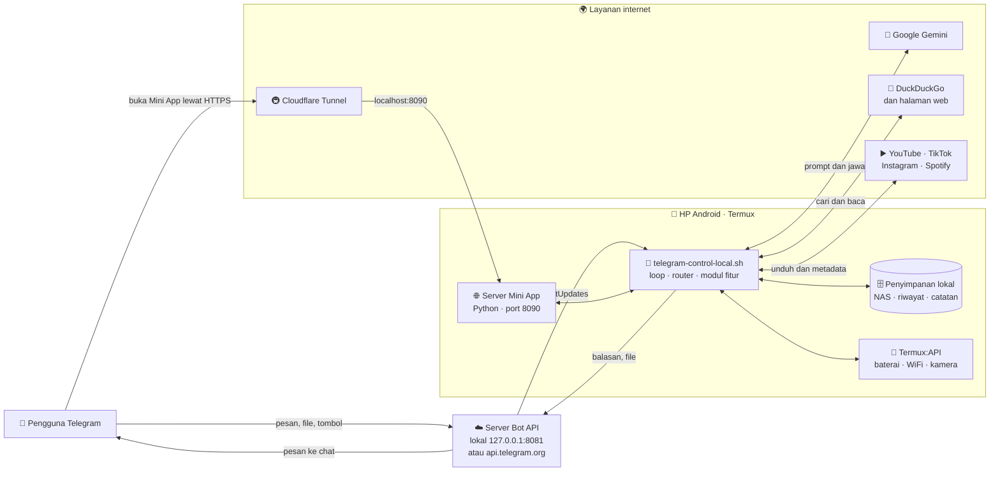

### Level 1 — Perjalanan satu pesan

Jalur utama sebuah pesan: dicek dulu siapa pengirimnya, lalu dipilah menurut jenis kirimannya.

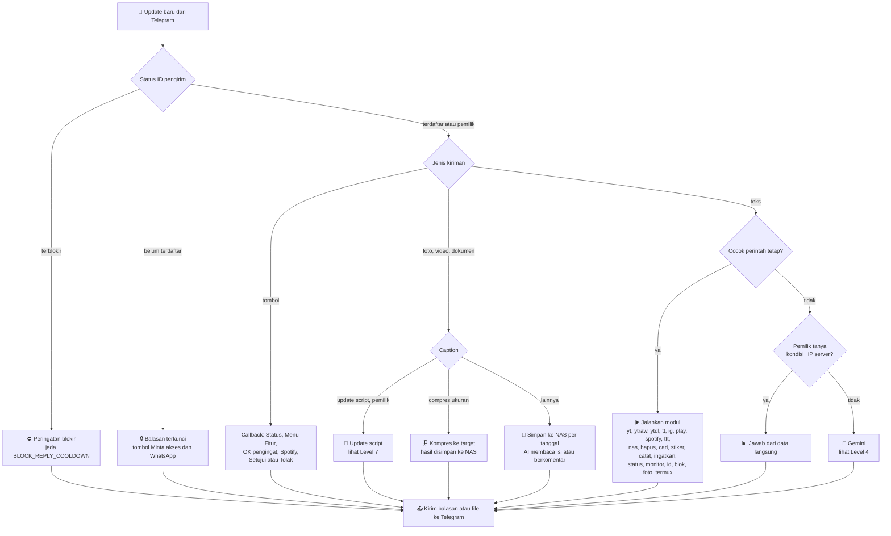

### Level 2 — Siklus loop utama

Bot tidak hanya menunggu pesan. Di setiap putaran ada pekerjaan berkala yang berjalan **walau tidak ada pesan masuk**.

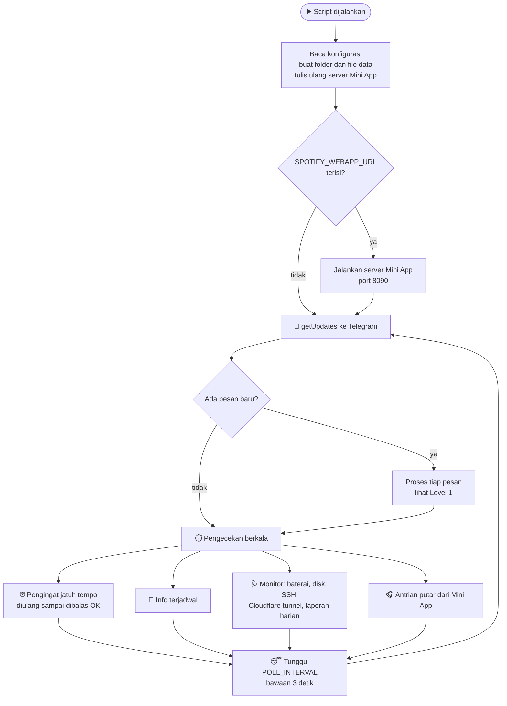

### Level 3 — Akses dan whitelist

Hanya `OWNER_CHAT_ID` dan ID tambahan yang dilayani. ID asing tidak pernah sampai ke fitur apa pun.

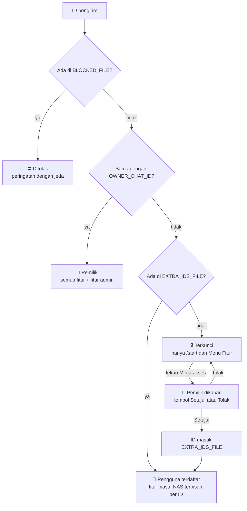

### Level 4 — Otak AI dan penanda

Gemini tidak menjalankan apa pun sendiri. Ia **menulis penanda** di jawabannya, lalu script yang mengenalinya, menjalankan aksinya, dan menyembunyikan penandanya dari pengguna.

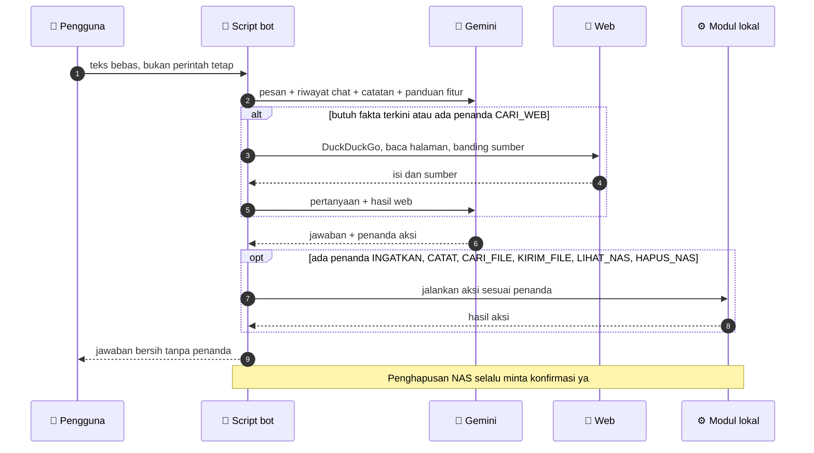

Daftar lengkap penanda ada di [Penanda AI](#penanda-ai-internal).

### Level 5 — Unduh, musik, dan kompres

Hasil unduhan memakai **file sementara** (`mktemp`) yang dihapus setelah terkirim.

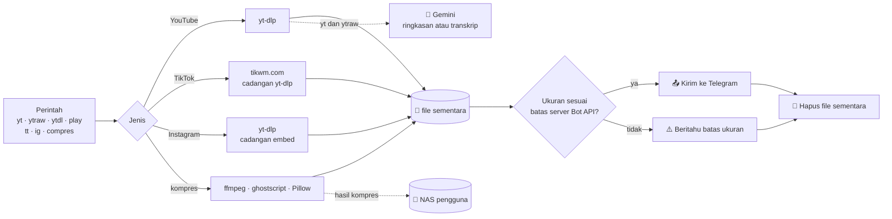

### Level 6 — Mini App Spotify dan game

Mini App adalah halaman web kecil yang dilayani dari HP-mu lalu dibuka **di dalam Telegram** lewat HTTPS publik dari Cloudflare Tunnel.

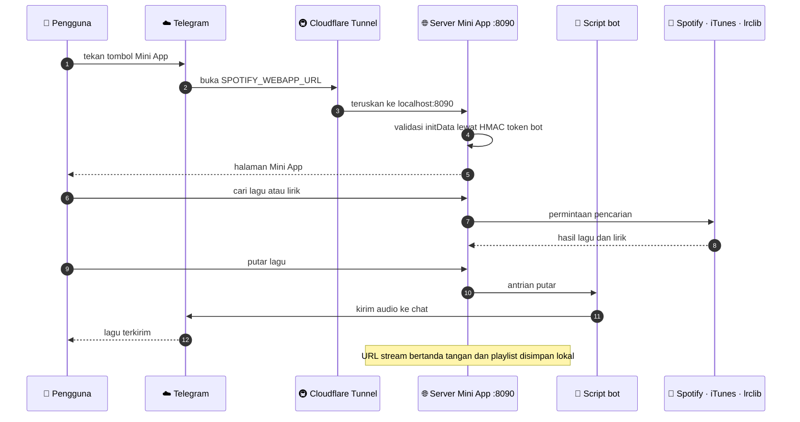

### Level 7 — Update script dan rollback

Hanya pemilik yang bisa memperbarui script lewat Telegram. Jika versi baru bermasalah, bot **kembali ke versi lama otomatis**.

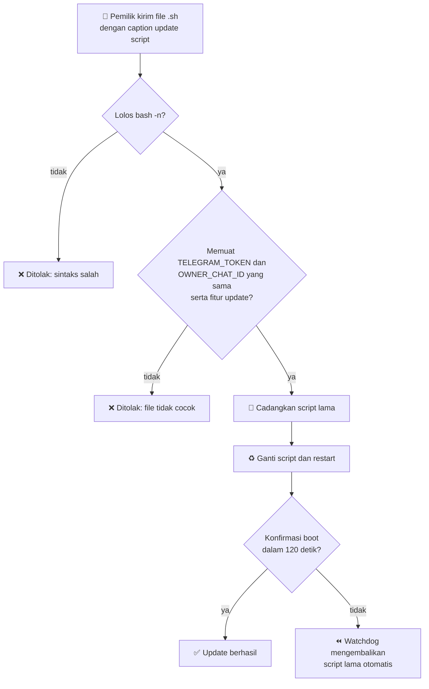

### Level 8 — Data di penyimpanan

Semua data ada di HP dalam folder pengguna Termux. Rincian tiap file ada di [File yang Dibuat Bot](#-file-yang-dibuat-bot).

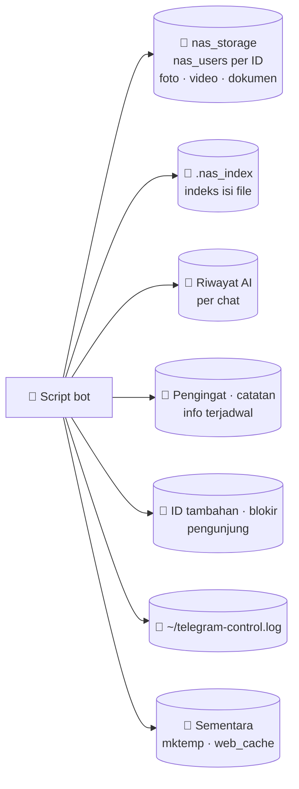

### Level 9 — Pengingat dan info terjadwal

Pengingat dibuat dari perintah `ingatkan` atau penanda AI, lalu diperiksa **tiap putaran loop**. Pengingat yang belum dibalas diulang sampai kamu menanggapi.

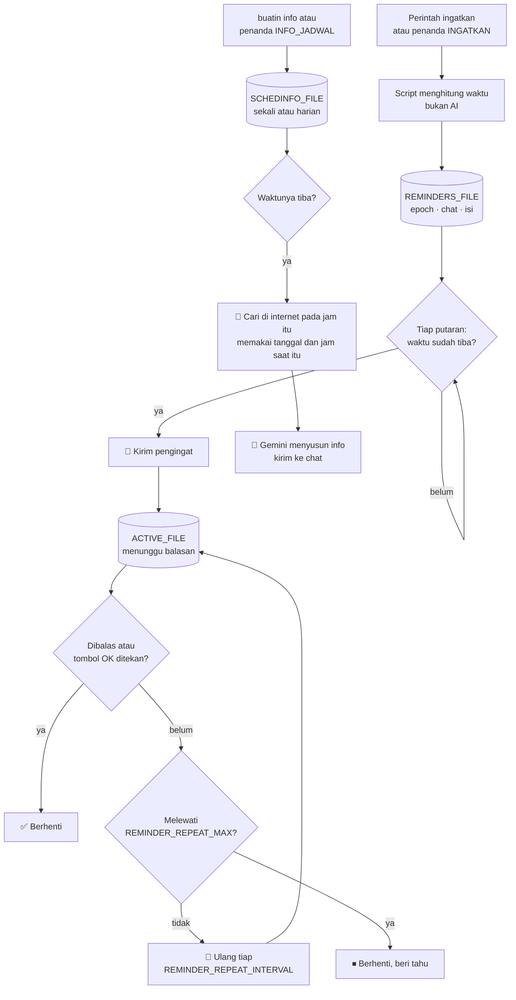

### Level 10 — NAS dan indeks pencarian

Tiap pengguna punya folder NAS sendiri. Setiap file yang disimpan masuk ke **indeks** supaya bisa dicari lewat `cari` atau lewat AI.

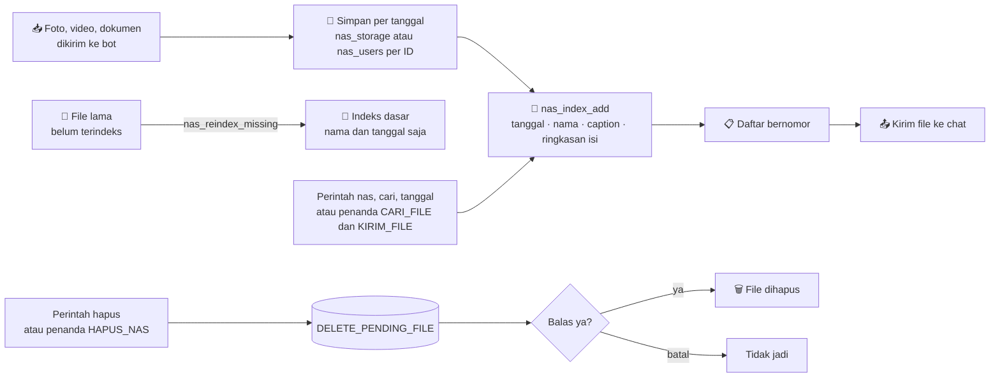

### Level 11 — Monitor dan laporan harian

Hanya **pemilik** yang menerima peringatan. Peringatan dikirim saat status **berubah** (normal → bermasalah atau sebaliknya), jadi tidak membanjiri chat.

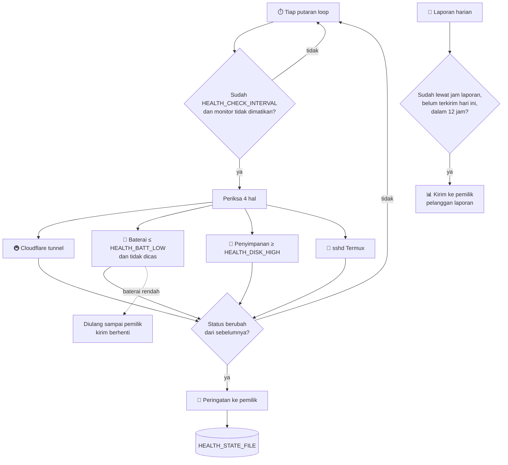

### Level 12 — Dokumen dan OCR PDF

Dokumen dibaca penuh, lalu dijawab sesuai caption. Halaman PDF hasil scan dibaca AI per kloter.

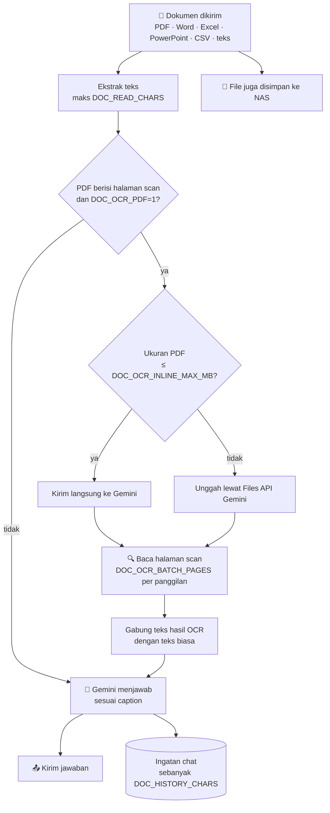

### Level 13 — Mulai otomatis dan watchdog

Dari HP menyala sampai bot hidup, dan bagaimana bot dinyalakan lagi bila mati. Ini versi diagram dari [Langkah 9](#langkah-9--jalan-permanen).

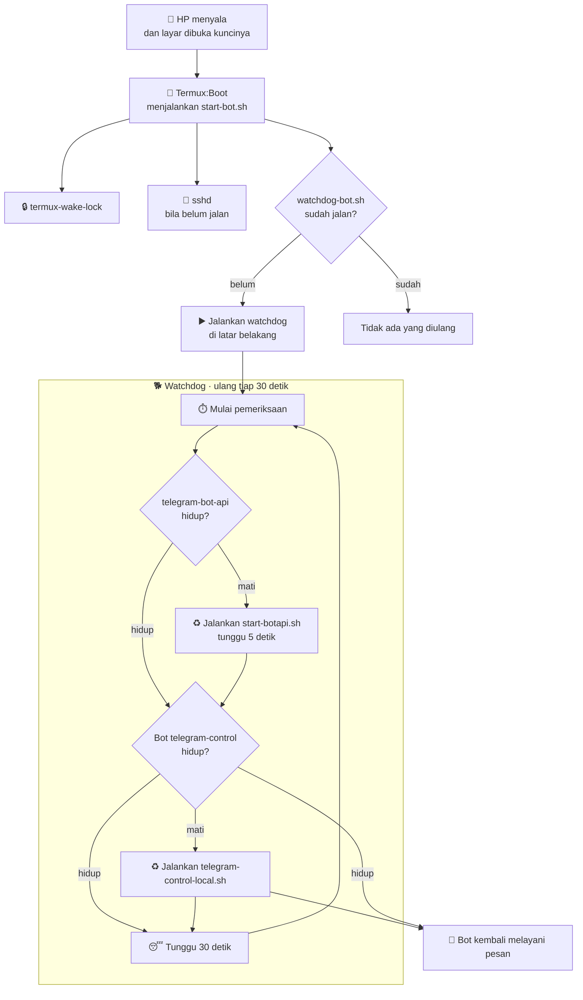

Blok `telegram-bot-api` hanya dipakai di **Jalur B**. Pada Jalur A, hapus blok itu dari `watchdog-bot.sh`.

### Hal penting

- **Whitelist ID.** Hanya `OWNER_CHAT_ID` dan ID tambahan yang terdaftar yang dilayani. ID lain hanya bisa `/start` dan membuka Menu Fitur; sisanya "terkunci".
- **Server Bot API lokal.** Script dirancang untuk [`telegram-bot-api`](https://github.com/tdlib/telegram-bot-api) lokal sehingga batas unggah/unduh file besar (hingga 2 GB per file) tidak dibatasi oleh server Telegram biasa. Server resmi tetap bisa dipakai dengan batas lebih kecil (lihat [Jalur A dan B](#langkah-5--pilih-jalur-server-bot-api)).
- **AI memakai penanda khusus.** Gemini menulis penanda seperti `[[INGATKAN: …]]`, `[[CARI_FILE: …]]`, `[[CATAT: …]]`, `CARI_WEB` yang dikenali script lalu dijalankan (lihat [Penanda AI](#penanda-ai-internal)).
- **Perintah tetap didahulukan.** Teks yang cocok dengan perintah (`yt`, `nas`, `ingatkan`, dst.) langsung dijalankan tanpa lewat AI; sisanya baru ditanyakan ke Gemini.
- **Pertanyaan fakta terkini selalu dicari.** Berita, harga, skor, dan sejenisnya dicari di web walaupun AI tidak meminta.
- **Satu file.** Seluruh fitur (termasuk server Mini App Python) ada di satu file `.sh`; server Mini App ditulis ulang otomatis tiap bot dijalankan.
- **Folder `potongan-script-sh/` hanya bahan baca.** Isinya potongan hasil pemisahan dari `telegram-control-local-opensource.sh` per bahasa (Python, HTML, CSS, JavaScript, dan teks pesan), supaya kode lebih mudah dipelajari. Folder ini **tidak dipakai saat bot berjalan**; yang dijalankan tetap script `.sh`-nya. Mengubah file di folder itu tidak mengubah perilaku bot.

---

## 📋 Persyaratan

| Kebutuhan | Keterangan |
|---|---|
| 📱 HP Android | Android 7+ , ruang kosong minimal 2 GB (lebih besar bila NAS dipakai banyak) |
| 🖥️ **Termux** | Pasang dari **F-Droid** atau GitHub release. **Jangan** dari Play Store (versi lama, tidak diperbarui) |
| 📲 **Termux:API** | Hanya untuk `foto`, baterai, WiFi. Aplikasi dan paket **harus dari sumber yang sama** dengan Termux (F-Droid dengan F-Droid) |
| 🌐 Internet | Koneksi stabil; WiFi disarankan untuk unduh besar |
| 🤖 Bot Telegram | Dari [@BotFather](https://t.me/BotFather) (gratis) |
| 🧠 API key Gemini | Dari [aistudio.google.com](https://aistudio.google.com) (ada kuota gratis) |
| 🔑 `api_id` dan `api_hash` | **Hanya Jalur B** (server Bot API lokal), dari [my.telegram.org](https://my.telegram.org) |
| 🚇 Akun Cloudflare | **Opsional**, hanya bila ingin Mini App; tunnel cepat (`trycloudflare`) tidak butuh akun |

### Lingkungan yang sudah teruji

Bot ini berjalan di perangkat berikut (spesifikasi rendah pun cukup):

| Komponen | Versi |
|---|---|
| HP | Samsung, Android 8.1 (SDK 27), arsitektur `armv8l` (32-bit) |
| Termux | 0.118.3 |
| RAM | ±2,8 GB (bot berjalan terus 7 hari tanpa restart pada uji ini) |
| Python | 3.14 |
| yt-dlp | 2026.10 (dengan `--js-runtimes node`) |
| Node.js | 26 |
| ffmpeg | 9.0 |
| cloudflared | 2026.10 |
| Server Bot API | `telegram-bot-api` lokal di `127.0.0.1:8081` |

### Paket yang dibutuhkan

| Paket | Dipakai untuk | Wajib? |
|---|---|---|
| `bash`, `curl`, `python`, `procps` | Inti script, uptime | ✅ |
| `ffmpeg` | Gabung video+audio, MP3, kompres video/foto/audio | ✅ untuk media |
| `yt-dlp` (pip) | `yt`, `ytraw`, `ytdl`, `play`, `ig`, cadangan `tt` | ✅ untuk media |
| `nodejs` | Runtime JavaScript yang dibutuhkan yt-dlp terbaru untuk YouTube (aktifkan dengan `--js-runtimes node`) | ✅ untuk YouTube |
| `ghostscript`, `poppler` | Kompres PDF, baca teks PDF | disarankan |
| `python-pillow` | Stiker teks, kompres foto | disarankan |
| `openpyxl`, `pypdf` (pip) | Excel pengunjung, pemrosesan PDF | disarankan |
| `openssh` | Pemeriksaan `sshd` | opsional |
| `termux-api` | Foto kamera, baterai, WiFi | opsional |
| `tmux`, `git` | Jalan di latar belakang, unduh repo | ✅ disarankan |
| `cloudflared` | Tunnel HTTPS untuk Mini App | opsional |
| `telegram-bot-api` | Server Bot API lokal (Jalur B), dikompilasi sendiri (lihat Langkah 5) | opsional |

---

## 🚀 Instalasi Lengkap dari 0 sampai 100%

Ikuti **berurutan**. Tiap langkah ditutup dengan ✅ **Cek** supaya kamu tahu sudah benar sebelum lanjut. Waktu total sekitar 20–40 menit.

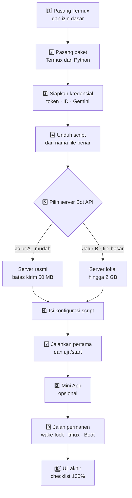

### Langkah 1 — Pasang Termux dan izin dasar

1. Pasang **F-Droid**, lalu pasang **Termux** (dan **Termux:API**, **Termux:Boot** bila ingin) dari sana.
2. Buka Termux, lalu beri akses penyimpanan dan ganti mirror bila unduhan lambat:

```bash
termux-setup-storage      # izinkan akses penyimpanan
termux-change-repo        # pilih mirror terdekat (opsional)
```

✅ **Cek:** `echo $PREFIX` menampilkan `/data/data/com.termux/files/usr`.

### Langkah 2 — Pasang paket

```bash
pkg update -y && pkg upgrade -y
pkg install -y bash curl git tmux python ffmpeg ghostscript poppler python-pillow procps openssh termux-api nodejs
pip install -U yt-dlp openpyxl pypdf

# YouTube terbaru butuh runtime JavaScript untuk yt-dlp; arahkan ke Node.js
mkdir -p ~/.config/yt-dlp
echo "--js-runtimes node" > ~/.config/yt-dlp/config
```

> Bila `pip` mengeluh soal build, jalankan `pkg install -y clang make` lalu ulangi.

✅ **Cek:**

```bash
for c in curl python ffmpeg gs pdftotext yt-dlp tmux git node; do command -v $c >/dev/null && echo "✅ $c" || echo "❌ $c"; done
```

### Langkah 3 — Siapkan kredensial

| Yang dicari | Cara |
|---|---|
| **`TELEGRAM_TOKEN`** | Chat [@BotFather](https://t.me/BotFather) → `/newbot` → ikuti langkahnya → salin token (format `123456789:AAH...`) |
| **`OWNER_CHAT_ID`** | Chat [@userinfobot](https://t.me/userinfobot) → salin angka `Id` |
| **`GEMINI_API_KEY`** | Buka [aistudio.google.com](https://aistudio.google.com) → **Get API key** → buat dan salin |
| `api_id`, `api_hash` (Jalur B) | Login [my.telegram.org](https://my.telegram.org) → **API development tools** → buat aplikasi |

> 🔐 Token dan API key itu seperti kata sandi. Jangan dibagikan ke siapa pun.

### Langkah 4 — Unduh script dan beri nama yang benar

```bash
cd ~
git clone https://github.com/devminionprojects/bot-telegram-by-devmp.git
cd bot-telegram-by-devmp

# Salin ke NAMA YANG BENAR di folder home
cp telegram-control-local-opensource.sh ~/telegram-control-local.sh
chmod +x ~/telegram-control-local.sh
```

Alternatif jika kamu sudah memasang GitHub CLI (`gh`) dan sudah login (`gh auth login`):

```bash
gh repo clone devminionprojects/bot-telegram-by-devmp
cd bot-telegram-by-devmp
```

> ℹ️ `git clone` tidak butuh akun GitHub dan sudah cukup untuk repo publik; `gh` hanya alternatif. `gh` tidak terpasang secara bawaan di Termux, jadi gunakan `git clone` kalau ragu.

> ⚠️ **Nama file harus `telegram-control-local.sh` (atau `telegram-control.sh`).**
> Perintah `status` mencari proses dengan nama itu; file bernama `telegram-control-local-opensource.sh` akan membuat status bot selalu tampil ❌ walau bot berjalan. Itu sebabnya file disalin dengan nama baru.
> Shebang script: `#!/data/data/com.termux/files/usr/bin/bash`.

> 📁 Kamu hanya perlu `telegram-control-local-opensource.sh`. Folder `potongan-script-sh/` tidak perlu disalin; itu hanya bahan baca (lihat [Hal penting](#hal-penting)).

✅ **Cek:** `bash -n ~/telegram-control-local.sh && echo "sintaks OK"`

### Langkah 5 — Pilih jalur server Bot API

| | **Jalur A: Server resmi** | **Jalur B: Server lokal** |
|---|---|---|
| Kesulitan | ⭐ mudah | ⭐⭐⭐ sedang |
| Alamat `TELEGRAM_API` | `https://api.telegram.org` | `http://127.0.0.1:8081` |
| Kirim file | maks **50 MB** | hingga **2 GB** |
| Unduh file dari chat | maks **20 MB** | hingga 2 GB |
| Butuh `api_id`/`api_hash` | tidak | ya |

> 💡 **Saran:** mulai dengan **Jalur A** sampai bot berjalan normal, baru pindah ke Jalur B kalau perlu file besar.

#### Jalur A — Server resmi

Tidak ada yang dipasang. Di langkah 6, isi `TELEGRAM_API="https://api.telegram.org"` dan turunkan batas ukuran kirim menjadi **49–50 MB** (lihat [Batas Ukuran](#-batas-ukuran-durasi-dan-waktu)).

#### Jalur B — Server lokal

Server lokal dibuat dengan **mengompilasi `telegram-bot-api` dari sumbernya** di Termux. Prosesnya lama (bisa puluhan menit) dan memakai banyak RAM, jadi biarkan HP tetap menyala dan terhubung ke charger.

```bash
# 1. Pasang alat kompilasi
pkg install -y git clang cmake make gperf openssl zlib

# 2. Unduh sumber (termasuk submodul td) dan kompilasi
git clone --recursive https://github.com/tdlib/telegram-bot-api.git ~/telegram-bot-api
cd ~/telegram-bot-api && mkdir -p build && cd build
cmake -DCMAKE_BUILD_TYPE=Release -DCMAKE_INSTALL_PREFIX:PATH=$PREFIX ..
cmake --build . --target install --parallel 1
```

> 💡 `--parallel 1` membuat kompilasi satu per satu agar HP ber-RAM kecil tidak kehabisan memori. Bila RAM cukup besar, angkanya boleh dinaikkan.
> Petunjuk build resmi dan pembuat perintah per sistem operasi ada di [tdlib.github.io/telegram-bot-api/build.html](https://tdlib.github.io/telegram-bot-api/build.html); ikuti itu bila perintah di atas gagal di versi Termux-mu.

✅ **Cek hasil kompilasi:** `command -v telegram-bot-api` menampilkan lokasi programnya.

```bash
# 3. Keluarkan bot dari server resmi (WAJIB sebelum pindah ke server lokal)
curl "https://api.telegram.org/bot<TOKEN>/logOut"

# 4. Buat skrip penjalan server lokal
cat > ~/start-botapi.sh <<'BOTAPI'
#!/data/data/com.termux/files/usr/bin/bash
mkdir -p "$HOME/botapi-data/tmp"
exec telegram-bot-api --api-id=<API_ID> --api-hash=<API_HASH> \
  --local --http-ip-address=127.0.0.1 --http-port=8081 \
  --dir="$HOME/botapi-data" --temp-dir="$HOME/botapi-data/tmp"
BOTAPI
chmod +x ~/start-botapi.sh

# 5. Jalankan di latar belakang
tmux new -d -s botapi '~/start-botapi.sh'
```

> `--dir` dan `--temp-dir` menentukan tempat server menyimpan file yang diunduh dan data sementara. Dengan mode `--local`, file besar disimpan di sini, jadi pastikan ruang penyimpanan cukup. Skrip ini berisi `api_hash`, jangan dibagikan.

✅ **Cek:** `curl http://127.0.0.1:8081/bot<TOKEN>/getMe` mengembalikan JSON dengan `"ok":true`.

> Setelah pindah ke server lokal, bot tidak bisa memakai server resmi lagi kecuali kamu memanggil `logOut` di server lokal terlebih dulu.

### Langkah 6 — Isi konfigurasi script

```bash
nano ~/telegram-control-local.sh
```

Isi minimal di bagian atas script:

```bash
TELEGRAM_TOKEN="123456789:AAH..."       # dari BotFather
OWNER_CHAT_ID="123456789"                # ID kamu
GEMINI_API_KEY="AIza..."                 # dari AI Studio
TELEGRAM_API="http://127.0.0.1:8081"     # Jalur B; Jalur A: https://api.telegram.org
```

Pengaturan opsional yang sering diubah: `LOCK_WA_NUMBER` (nomor WhatsApp untuk tombol minta akses), `SPOTIFY_*`, `SPOTIFY_WEBAPP_URL`. Daftar penuh ada di [Konfigurasi](#-konfigurasi).

Simpan di nano: `Ctrl+O`, `Enter`, `Ctrl+X`.

### Langkah 7 — Jalankan pertama dan uji

```bash
~/telegram-control-local.sh
```

Di Telegram, buka bot-mu lalu kirim **`/start`**, kemudian uji:

| Kirim | Hasil yang benar |
|---|---|
| `/start` | Menu sambutan dengan tombol |
| `halo` | Dijawab AI (jika tidak: cek `GEMINI_API_KEY`) |
| `status` | Menampilkan status bot ✅ (jika ❌: nama file salah) |
| `yt <link YouTube>` | Ringkasan video |

Hentikan sementara dengan `Ctrl+C`. Bila ada error, lihat `tail -n 50 ~/telegram-control.log`.

### Langkah 8 — Mini App (opsional)

Untuk `spotify` kartu dan game `ttt`. Perlu **URL HTTPS publik** ke port `8090`.

**Cara cepat (tanpa akun, URL berubah tiap start):**

```bash
pkg install -y cloudflared
tmux new -d -s tunnel 'cloudflared tunnel --url http://127.0.0.1:8090 2>&1 | tee ~/quicktunnel.log'
sleep 10
grep -o 'https://[a-z0-9-]*\.trycloudflare\.com' ~/quicktunnel.log | head -1 | tee ~/.quicktunnel_last_url
```

URL yang tampil juga disimpan di `~/.quicktunnel_last_url`, sehingga perintah `status` di bot ikut menampilkannya.

Salin URL itu ke `SPOTIFY_WEBAPP_URL` di script, lalu restart bot.

**Cara tetap (butuh akun dan domain Cloudflare, URL tidak berubah):** buat tunnel di dashboard Cloudflare Zero Trust, arahkan hostname ke `http://localhost:8090`, jalankan `cloudflared tunnel run --token <TOKEN_TUNNEL>`, lalu pakai hostname itu sebagai `SPOTIFY_WEBAPP_URL`.

> Monitor bot memeriksa proses `cloudflared`; bila mati, pemilik dikabari.

✅ **Cek:** kirim `ttt`; tombol Mini App muncul dan terbuka di dalam Telegram.

### Langkah 9 — Jalan permanen

```bash
termux-wake-lock                         # cegah CPU tidur
tmux new -d -s bot '~/telegram-control-local.sh'
tmux ls                                  # pastikan sesi 'bot' ada
```

Agar tahan lama di Android:

1. **Matikan optimasi baterai** untuk Termux (Pengaturan → Aplikasi → Termux → Baterai → *Tanpa batasan*).
2. Kunci Termux di daftar aplikasi terbaru bila HP-mu agresif mematikan aplikasi.
3. **Android 12+:** proses latar sering dibunuh *phantom process killer*; matikan lewat Opsi Pengembang atau perintah `adb` sesuai versi Androidmu.
4. **Mulai otomatis saat HP menyala, dan hidup lagi bila bot mati**, dengan Termux:Boot ditambah *watchdog*. Watchdog adalah skrip kecil yang berjalan terus dan tiap 30 detik memeriksa apakah server Bot API dan bot masih hidup, lalu menyalakannya lagi bila mati.

Buat skrip watchdog:

```bash
cat > ~/watchdog-bot.sh <<'WD'
#!/data/data/com.termux/files/usr/bin/bash
while true; do
  # Hapus blok ini bila memakai Jalur A (tanpa server Bot API lokal)
  if ! pgrep -f telegram-bot-api >/dev/null; then
    nohup "$HOME/start-botapi.sh" >> "$HOME/botapi.log" 2>&1 &
    sleep 5
  fi
  if ! pgrep -f "telegram-control(-local)?\.sh" >/dev/null; then
    nohup bash "$HOME/telegram-control-local.sh" >/dev/null 2>&1 &
  fi
  sleep 30
done
WD
chmod +x ~/watchdog-bot.sh
```

Lalu buat skrip Boot yang menyalakannya (aman dijalankan berkali-kali):

```bash
mkdir -p ~/.termux/boot
cat > ~/.termux/boot/start-bot.sh <<'BOOT'
#!/data/data/com.termux/files/usr/bin/bash
termux-wake-lock
pgrep -x sshd >/dev/null || sshd                 # opsional: hapus bila tidak memakai SSH
pgrep -f watchdog-bot.sh >/dev/null || { nohup bash ~/watchdog-bot.sh >/dev/null 2>&1 & disown; }
BOOT
chmod +x ~/.termux/boot/start-bot.sh
```

Buka aplikasi **Termux:Boot** sekali agar terdaftar. Setelah HP menyala dan dibuka kuncinya, bot hidup sendiri dalam sekitar satu menit.

> ⚠️ Arahkan keluaran bot ke `/dev/null` (seperti di atas), **bukan** ke `~/telegram-control.log`. Bot sudah menulis log sendiri; mengarahkannya ke file yang sama membuat setiap baris log tampil dobel.

### Langkah 10 — Checklist 100%

Bot dianggap **siap 100%** bila semua centang:

- [ ] `tmux ls` menampilkan sesi `bot` (dan `botapi` bila Jalur B)
- [ ] `/start` mendapat balasan menu
- [ ] Pesan biasa dijawab AI
- [ ] `status` menampilkan bot ✅ dan data RAM/baterai
- [ ] `yt <link>` dan `ytdl <link>` berhasil
- [ ] Kirim sebuah foto → tersimpan di NAS (`nas`)
- [ ] `ingatkan 1 menit tes` → pengingat muncul
- [ ] `compres` pada sebuah file berhasil
- [ ] `ttt` / `spotify` membuka Mini App (bila Langkah 8 dilakukan)
- [ ] `foto` mengirim foto kamera (bila Termux:API dipasang)
- [ ] Setelah HP di-restart, bot hidup sendiri (bila Termux:Boot dipasang)

---

## 🔧 Konfigurasi

Semua pengaturan berupa variabel di **bagian atas script** (±120 baris pertama) dan di **awal tiap blok fitur** (YouTube, TikTok, Instagram, kompres, stiker, Spotify, dst.). Cari dengan `grep -n '^NAMA_VARIABEL=' telegram-control-local.sh`. Nilai `0` pada banyak batas berarti **tanpa batas**.

### Wajib diisi

| Variabel | Keterangan |
|---|---|
| `TELEGRAM_TOKEN` | Token bot dari BotFather |
| `OWNER_CHAT_ID` | ID Telegram pemilik (selalu diizinkan, satu-satunya yang bisa menambah pengguna) |
| `GEMINI_API_KEY` | API key Gemini dari aistudio.google.com |
| `TELEGRAM_API` | Alamat server Bot API (`http://127.0.0.1:8081` untuk lokal; `https://api.telegram.org` untuk server resmi) |

### Akses & pengguna

| Variabel | Bawaan | Keterangan |
|---|---|---|
| `EXTRA_IDS_FILE` | `~/.telegram_extra_ids` | Daftar ID tambahan (1 ID per baris) |
| `MAX_EXTRA_IDS` | `0` | Batas jumlah ID tambahan (`0` = tanpa batas) |
| `LOCK_WA_NUMBER` / `LOCK_WA_DISPLAY` | – | Nomor WhatsApp pemilik untuk tombol "minta buka kunci" |
| `LOCK_REPLY_COOLDOWN` | `10` | Jeda balasan "terkunci" ke ID yang sama (detik) |
| `BLOCKED_FILE` | `~/.telegram_blocked` | Daftar ID yang diblokir |
| `BLOCK_REPLY_COOLDOWN` | `60` | Jeda balasan peringatan blokir |
| `VISITORS_NOTIFY` | `1` | Catat & kabari pemilik tiap ada pengunjung `/start` baru |
| `DEVELOPER_CHAT_ID` | – | ID yang dikenali AI sebagai developer (sambutan khusus) |
| `ACCESS_REQ_COOLDOWN` | `3600` | Jeda sebelum ID yang masih menunggu persetujuan dikabarkan lagi ke pemilik (detik) |
| `ACCESS_REJECT_COOLDOWN` | `3600` | Jeda sebelum ID yang sudah ditolak muncul lagi di notifikasi (detik) |
| `POLL_INTERVAL` | `3` | Jeda polling (detik) |

### Tampilan

| Variabel | Bawaan | Keterangan |
|---|---|---|
| `BANNER_PHOTO` | `~/banner.jpg` | Foto banner pada `/start` |
| `BANNER_VIDEO` | `~/banner.mp4` | Video banner (bila ada, foto diabaikan) |
| `WELCOME_WIDTH_PAD` | `36` | Pelebar kotak "Informasi Bot" |

### NAS & file

| Variabel | Bawaan | Keterangan |
|---|---|---|
| `NAS_SEND_MAX` | `0` | Maks file yang dikirim saat pencarian (`0` = semua) |
| `NAS_FILE_MAX_BYTES` | `0` | Batas ukuran file kirim. Server resmi: `50000000` |
| `NAS_PHOTO_MAX_BYTES` | `0` | Foto di atas ukuran ini dikirim sebagai dokumen |
| `NAS_SEND_TIMEOUT` | `0` | Batas waktu kirim satu file (detik) |
| `DELETE_CONFIRM_TTL` | `120` | Waktu menjawab "ya" sebelum permintaan hapus hangus |

### Dokumen & AI

| Variabel | Bawaan | Keterangan |
|---|---|---|
| `DOC_READ_CHARS` | `1000000` | Batas karakter isi dokumen yang dibaca |
| `DOC_HISTORY_CHARS` | `0` | Karakter dokumen yang disimpan di ingatan (`0` = utuh) |
| `DOC_OCR_PDF` | `1` | OCR halaman PDF hasil scan lewat AI |
| `DOC_OCR_BATCH_PAGES` | `10` | Halaman scan per satu panggilan AI |
| `DOC_OCR_MAX_MB` | `1024` | Ukuran PDF maksimal yang dibaca |
| `DOC_OCR_INLINE_MAX_MB` | `14` | PDF ≤ ini dikirim langsung; lebih besar via Files API Gemini |
| `YT_GEMINI_MODEL` | `gemini-2.5-flash` | Model untuk baca video langsung (cadangan `yt`) |

### Pencarian web

| Variabel | Bawaan | Keterangan |
|---|---|---|
| `WEB_SEARCH_MAX` | `0` | Maks pencarian lanjutan per pertanyaan |
| `DDG_DOH_URL` | `https://cloudflare-dns.com/dns-query` | DNS-over-HTTPS untuk menembus blokir DNS ISP |
| `DDG_MAX_RESULTS` | `5` | Jumlah hasil ke AI (1–5) |
| `DDG_POOL` | `8` | Hasil teratas yang jadi kandidat |
| `DDG_READ_PAGES` | `5` | Halaman teratas yang dibuka |
| `DDG_PAGE_CHARS` / `DDG_TOTAL_CHARS` | `1000000` | Batas karakter per halaman / total |
| `BIG_DL_LIMIT` | `100000000` | Halaman > 100 MB ditanyakan dulu |
| `BIG_DL_WAIT` | `300` | Menunggu jawaban ya/batal (detik) |
| `BIG_DL_STALL` | `120` | Hentikan unduhan yang macet total (detik) |
| `PAGE_TYPE_PRECHECK` | `1` | Cek jenis berkas sebelum unduh |
| `WEB_WANT_MAX` | `100` | Batas wajar jumlah yang diminta ("20 berita") |
| `WEB_MAX_SERP_PAGES` | `0` | Maks halaman hasil DuckDuckGo |
| `DDG_VERIFY_MAX` | `4` | Gambar yang dibandingkan dengan foto kiriman |
| `DDG_TRUSTED_DOMAINS` | daftar | Sumber terpercaya (ditandai & didahulukan) |
| `DDG_PRIMARY_DOMAINS` | daftar | Sumber resmi/primer |
| `DDG_LOW_DOMAINS` | daftar | Sumber kurang terpercaya |

### Pengingat, catatan, info terjadwal

| Variabel | Bawaan | Keterangan |
|---|---|---|
| `REMINDER_REPEAT_INTERVAL` | `60` | Jeda ulang pengingat yang belum dibalas (detik) |
| `REMINDER_REPEAT_MAX` | `0` | Maks ulang (`0` = sampai dibalas) |
| `SCHEDINFO_MAX` | `0` | Maks info terjadwal per chat |
| `NOTES_FILE` | `~/.telegram_notes` | Lokasi catatan |

### Monitoring & laporan

| Variabel | Bawaan | Keterangan |
|---|---|---|
| `DAILY_DEFAULT_TIME` | `07:00` | Jam laporan harian |
| `HEALTH_CHECK_INTERVAL` | `10` | Jeda pemeriksaan kesehatan (detik) |
| `HEALTH_BATT_LOW` | `10` | Peringatan baterai ≤ persen ini |
| `BATT_SPAM_INTERVAL` | `30` | Jeda pesan baterai rendah (`0` = tidak diulang) |
| `HEALTH_DISK_HIGH` | `90` | Peringatan disk ≥ persen ini |
| `HEALTH_SSH_CHECK` | `1` | Cek `sshd` |
| `LOG_VERBOSE` | `1` | Tampilkan log di layar |
| `LOG_FILE` | `~/telegram-control.log` | File log (otomatis dikosongkan bila > 1 MB) |

### YouTube

| Variabel | Bawaan | Keterangan |
|---|---|---|
| `YT_COOKIES` | `~/yt-cookies.txt` | Cookie Netscape (opsional; untuk video dibatasi umur / dianggap bot) |
| `YT_MAX_CHARS` | `0` | Batas karakter transkrip ke AI |
| `YT_DETAIL_CHUNK` | `24000` | Ukuran potongan transkrip mode `lengkap` |
| `YT_RAW_TIMESTAMP` | `1` | Awali baris transkrip dengan `[mm:ss]` |
| `YT_RAW_KIRIM_PESAN` | `1` | Kirim transkrip sebagai pesan chat |
| `YT_RAW_KIRIM_FILE` | `1` | Kirim juga file `.txt` |
| `YT_RAW_TERJEMAH` | `1` | Terjemahkan subtitle non-Indonesia dengan AI |
| `YT_RAW_BATCH` | `100` | Baris subtitle per sekali terjemah |
| `YTDL_HEIGHT` | `720` | Kualitas video bawaan (`0` = terbaik) |
| `YTDL_MP3_QUALITY` | `0` | Kualitas MP3 (0 terbaik … 10 terkecil) |
| `YTDL_MAX_SECS` | `0` | Batas durasi unduhan (`0` = tanpa batas) |
| `YTDL_MAX_MB` | `0` | Batas ukuran unduhan (`49` untuk server resmi) |
| `YTDL_PLAYLIST_MAX` | `5` | Jumlah video pertama pada playlist |
| `YTDL_DESC_MAX` | `2500` | Maks karakter deskripsi di pesan gabungan |

### Putar lagu (`play`)

| Variabel | Bawaan | Keterangan |
|---|---|---|
| `PLAY_SEARCH_N` | `10` | Jumlah hasil pencarian yang dibandingkan jumlah penontonnya |
| `PLAY_VIDEO` | `1` | `1` = kirim video + pemutar audio |
| `PLAY_VIDEO_HEIGHT` | `360` | Tinggi video (piksel) |
| `PLAY_VIDEO_MAX_SECS` | `900` | Lebih panjang dari ini → thumbnail + MP3 |
| `PLAY_MAX_MB` | `0` | Batas ukuran (`49` untuk server resmi) |
| `PLAY_VIDEO_AUDIO` | `1` | Sertakan pemutar audio pada pesan video |
| `PLAY_VIDEO_AUTOPLAY` | `2` | `2` = satu pesan video bersuara + pemutar audio; `1` = dua pesan; `0` = video biasa |

### TikTok, Instagram, Kompres, Stiker

| Variabel | Bawaan | Keterangan |
|---|---|---|
| `TT_API` | `https://www.tikwm.com/api/` | Sumber utama TikTok |
| `TT_HD` | `1` | Ambil HD jika ada |
| `IG_COOKIES` | `~/ig-cookies.txt` | Cookie Instagram (wajib untuk story/highlight/akun privat) |
| `COMPRESS_MARGIN` | `95` | Bidik 95% dari target ukuran |
| `STICKER_MAX_CHARS` | `300` | Batas panjang teks stiker |
| `STICKER_FONT` | kosong | Path font `.ttf` bold sendiri (opsional) |

### Spotify & Mini App

| Variabel | Bawaan | Keterangan |
|---|---|---|
| `SPOTIFY_SOURCE` | `auto` | Sumber pencarian (Spotify bila ada kredensial, jika tidak iTunes) |
| `SPOTIFY_CLIENT_ID` / `SPOTIFY_CLIENT_SECRET` | kosong | Dari developer.spotify.com/dashboard (opsional) |
| `SPOTIFY_PAGE_SIZE` | `5` | Lagu per halaman |
| `SPOTIFY_COUNTRY` | `ID` | Negara untuk iTunes |
| `SPOTIFY_WEBAPP_URL` | – | URL **HTTPS** Mini App (kosong = Mini App mati; juga dibutuhkan game `ttt`) |
| `SPOTIFY_APP_PORT` | `8090` | Port lokal server Mini App (arahkan Cloudflare Tunnel ke sini) |
| `SPOTIFY_VIDEO_KEEP` | `8` | Jumlah video terakhir yang disimpan di cache |

### Update script & Termux

| Variabel | Bawaan | Keterangan |
|---|---|---|
| `UPDATE_BACKUP_DIR` | `~/telegram-control-backup` | Folder cadangan script lama |
| `UPDATE_BACKUP_KEEP` | `5` | Jumlah cadangan disimpan |
| `UPDATE_WATCHDOG_SECONDS` | `120` | Batas waktu script baru melapor aktif sebelum rollback |
| `UPDATE_MAX_BYTES` | `3000000` | Ukuran maksimal file script yang diterima |
| `TERMUX_CONFIRM_TTL` | `120` | Waktu membalas "ya" sebelum perintah hangus |
| `TERMUX_CMD_TIMEOUT` | `120` | Batas waktu perintah berjalan |
| `TERMUX_SAFETY` | `0` | `1` = aktifkan daftar larangan perintah berbahaya |
| `FOTO_BOLEH_SEMUA` | `0` | `1` = semua ID terdaftar boleh memakai `foto` (**hati-hati**) |
| `FOTO_HAPUS_DETIK` | `60` | Foto kamera dihapus dari chat setelah sekian detik |

---

## 🏁 Menjalankan, Menjaga, dan Memperbarui Bot

### Perintah harian

| Tujuan | Perintah |
|---|---|
| Jalankan langsung (uji) | `~/telegram-control-local.sh` |
| Jalankan di latar belakang | `tmux new -d -s bot '~/telegram-control-local.sh'` |
| Lihat layar bot | `tmux attach -t bot` (lepas: `Ctrl+B` lalu `D`) |
| Hentikan bot | `tmux kill-session -t bot` |
| Restart bot | `tmux kill-session -t bot; tmux new -d -s bot '~/telegram-control-local.sh'` |
| Lihat log | `tail -f ~/telegram-control.log` |
| Cek proses | `pgrep -fa telegram-control` |

### Jalan otomatis

Gunakan **Termux:Boot** ([Langkah 9](#langkah-9--jalan-permanen)). Alternatif ringan, tambahkan di `~/.bashrc`:

```bash
pgrep -f "telegram-control(-local)?\.sh" >/dev/null || tmux new -d -s bot '~/telegram-control-local.sh'
```

### Cadangan data

Semua data ada di folder home Termux. Cadangkan secara berkala:

```bash
cd ~ && tar czf ~/backup-bot-$(date +%F).tar.gz telegram-control-local.sh nas_storage .telegram_* 2>/dev/null
```

Salin arsip itu ke penyimpanan HP (`~/storage/shared/`) atau komputer. Jangan unggah ke tempat umum karena berisi token.

### Memperbarui script

| Cara | Langkah |
|---|---|
| **Lewat Telegram (disarankan)** | Pemilik mengirim file `.sh` baru dengan caption `update script`. Bot memeriksa sintaks, mencadangkan, mengganti, dan **rollback otomatis** bila tidak sehat dalam 120 detik (lihat [Level 7](#level-7--update-script-dan-rollback)). Pastikan token dan ID pemilik di file baru **sama** |
| **Manual** | `cp ~/telegram-control-local.sh ~/telegram-control-local.sh.bak`, ganti file, `bash -n` untuk cek, lalu restart bot |
| **Perbarui yt-dlp** | `pip install -U yt-dlp` (sering perlu bila YouTube/Instagram gagal) |

---

## 💬 Daftar Perintah

Banyak perintah juga bisa diketik dengan garis miring (`/yt`, `/play`, dst.) dan sebagian dipahami lewat **bahasa biasa** di chat.

### Untuk semua pengguna terdaftar

| Perintah | Fungsi | Contoh |
|---|---|---|
| `/start` | Sambutan, banner, tombol Menu Fitur | `/start` |
| *(teks biasa)* | Tanya apa saja ke AI (ingat obrolan & file) | `jelaskan apa itu machine learning` |
| *(kirim foto/video)* | Dikomentari AI (caption = pertanyaan) | foto + `ini barang apa?` |
| *(kirim dokumen)* | Dibaca lengkap, jawab sesuai caption | PDF + `ringkas dokumen ini` |
| `lupakan` / `reset ai` | Hapus ingatan AI | `lupakan` |
| `web <kata kunci>` | Paksa cari di internet | `web harga emas hari ini` |
| `carikan 20 berita ...` | Minta jumlah hasil tertentu | `carikan 20 berita bola hari ini` |
| `cari lagi` / `update` / `cek ulang` | Paksa data baru | `cari lagi` |
| `nas` | Ringkasan file per tanggal | `nas` |
| `nas <tanggal>` | Daftar bernomor | `nas 03-10-2026` |
| `nas <tanggal> <no>` | Ambil 1 file | `nas 03-10-2026 1` / `nas 03-10-2026 foto 2` |
| `<tanggal>` | Ambil semua file hari itu | `21-09-2026` |
| `cari <kata> [bulan-tahun] [kirim]` | Cari file di NAS | `cari foto panel 10-2026 kirim` |
| `hapus <jenis> <tanggal> <no>` | Hapus file NAS milikmu (konfirmasi `ya`) | `hapus foto 03-10-2026 5` |
| `hapus <tanggal>` | Hapus semua file di tanggal itu | `hapus 20-11-2026` |
| `yt <link> [mode/pertanyaan]` | Ringkasan video YouTube oleh AI | `yt https://youtu.be/xxxx poin` |
| `ytraw <link>` | Transkrip YouTube + file `.txt` | `ytraw https://youtu.be/xxxx` |
| `ytdl <link>` | Unduh video MP4 | `ytdl https://youtu.be/xxxx` |
| `ytdl mp3 <link>` / `ytmp3 <link>` | Unduh audio MP3 | `ytmp3 https://youtu.be/xxxx` |
| `ytdl <kualitas> <link>` | Pilih kualitas | `ytdl 1080 https://youtu.be/xxxx` |
| `tt <link>` / `tt mp3 <link>` | Unduh TikTok tanpa watermark | `tt https://vt.tiktok.com/xxxx` |
| `ig <link>` / `ig mp3 <link>` | Unduh Instagram | `ig https://www.instagram.com/reel/xxxx` |
| `play <judul>` | Cari & putar lagu dari YouTube | `play sadrah` |
| `spotify <judul>` | Pencarian lagu bertombol | `spotify merry christmas` |
| `spotify` | Buka Mini App Spotify | `spotify` |
| *(kirim file + caption)* `compres <ukuran>` | Kompres ke ukuran target | caption `compres 60mb` |
| `ingatkan <waktu> <isi>` | Buat pengingat/timer | `ingatkan aku 30 menit lagi minum obat` |
| `pengingat` / `batal pengingat <no>` | Daftar / batalkan | `batal pengingat 1` |
| `spam ya` / `spam tidak` / `spam tanya` | Atur kebiasaan ulang pengingat | `spam ya` |
| `buatin info ...` | Info internet terjadwal | `setiap hari jam 6.00 carikan 20 berita` |
| `info terjadwal` / `batal info <no>` | Daftar / batalkan | `batal info 1` |
| `catat <isi>` | Simpan catatan | `catat password wifi: abc123` |
| `catatan [kata]` / `hapus catatan <no>` | Lihat, cari, hapus | `catatan wifi` |
| `stiker <teks>` | Teks → stiker putih | `stiker SELAMAT PAGI` |
| `ttt` | Game Tic Tac Toe (Mini App) | `ttt` |
| `waktu` | Cek jam server & status laporan | `waktu` |

### Khusus pemilik

| Perintah | Fungsi |
|---|---|
| `status` | RAM, baterai, suhu, WiFi, uptime, status tunnel dan bot |
| `monitor` / `monitor on` / `monitor off` | Cek / hidupkan / matikan peringatan otomatis |
| `laporan` / `laporan on` / `laporan off` / `laporan jam 06:30` | Laporan harian |
| `id <id>` / `hapusid <id>` / `listid` | Kelola pengguna tambahan |
| `blok <id>` / `bukablok <id>` / `listblok` | Blokir / buka blokir |
| `pengunjung` | Riwayat `/start` + file Excel |
| `backup` | File cadangan bot (pengingat, dll.) |
| `foto` / `foto belakang` | Foto kamera HP server |
| `/termux <permintaan>` | AI menyusun perintah shell (jalan setelah `ya`) |
| `/cmd <perintah>` | Jalankan perintah persis seperti ditulis (jalan setelah `ya`) |
| *(kirim `.sh` + caption)* `update script` | Update script bot dengan rollback otomatis |
| `nas all id [tanggal]` | Lihat NAS semua ID |
| `nas id <id> [tanggal]` | Kirim file NAS milik ID lain |
| `hapus nas id <id> ...` | Hapus file NAS ID lain (permanen, konfirmasi `ya`) |

### Alias dan perintah tambahan

Beberapa perintah punya nama lain atau cara pakai yang tidak tertulis di tabel di atas (sesuai pencocokan di script):

| Perintah | Alias / catatan |
|---|---|
| `ytraw <link>` | Juga `ytmentah` |
| `backup` | Juga `cadangan` (khusus pemilik) |
| `waktu` | Juga `cekjam` dan `cek jam` |
| `pengingat` | Juga `jadwal` |
| `info terjadwal` | Juga `infojadwal`, `jadwal info`, `daftar info` |
| `lupakan` | Juga `reset ai` dan `lupa` |
| `menu fitur` | Juga `/menufitur`; membuka daftar fitur lengkap |
| `blok <id>` | Juga `blokir` dan `ban` |
| `bukablok <id>` | Juga `unblok`, `unblokir`, `unban`, `buka blok`, `buka blokir` |
| `listblok` | Juga `listblokir`, `daftarblok`, `daftar blok` |
| `pengunjung` | Juga `riwayat` dan `riwayat pengunjung` |
| `status` | Juga `info` |
| `berhenti` / `stop` | Khusus pemilik: hentikan pengingat **baterai rendah** yang sedang diulang |
| `id <id>` / `id: <id>` | Tambah pengguna; pengguna baru otomatis dikabari. `hapusid` juga mengabari yang dicabut |

---

## 📖 Penjelasan Fitur Lengkap

### 🤖 AI Chat + Ingatan

- Memakai **Google Gemini**. Riwayat percakapan disimpan per chat (`~/.gemini_history_<chat_id>.json`).
- AI ingat obrolan, file yang dikirim (nama, tanggal tersimpan, isi/ringkasan), dan hasil tombol.
- Gaya bicara santai & humoris; tidak memakai simbol markdown mentah di Telegram.
- Catatan pengguna ikut dikirim ke Gemini setiap chat (jangan simpan yang terlalu rahasia).
- `lupakan` / `reset ai` menghapus ingatan.
- AI mengenali tanggal relatif (hari ini, besok, lusa, bulan lalu) dari kalender 15 hari yang diberikan script.

### 🖼️ Foto, Video & Dokumen

- **Foto/video** dikomentari AI; caption dijawab terlebih dulu. Jika ada yang janggal, AI memberi kritik dan saran.
- **Dokumen yang dibaca penuh:** PDF, Word (`docx/doc`), Excel (`xlsx/xls`), PowerPoint (`pptx/ppt`), OpenDocument (`odt/ods/odp`), RTF, CSV/TSV, teks biasa, dan file teks lain (json, log, kode).
- **PDF scan** dibaca lewat OCR AI (per kloter halaman) lalu digabung ke teks.
- Tidak terbaca: file terkunci/berpassword, arsip, audio, video (bot jujur menyatakan tidak terbaca).
- Dokumen tidak dicari di internet kecuali caption menyebut internet/web/google.
- Ringkasan dokumen masuk ke ingatan chat dan indeks pencarian NAS.

### 🔎 Pencarian Internet

- Pertanyaan berita, harga, skor, dll. di chat biasa otomatis dicari lewat **DuckDuckGo** (`web <kata>` untuk memaksa).
- Sebelum mencari, AI memeriksa riwayat chat; info cepat berubah (skor, harga, kurs, cuaca, berita) hanya dipakai dari riwayat bila dari hari ini.
- **Urutan sumber:** resmi/primer → terpercaya → lainnya (ditandai). Bot membuka dan membaca halaman sumber **dari atas sampai bawah**, mengecek tanggal terbit, penulis, HTTPS dan kecocokan isi, lalu **membandingkan antar sumber**. Fakta disebut pasti jika minimal 2 situs berbeda sepakat.
- **Jumlah tertentu** (`carikan 20 berita ...`): bot terus membaca sampai jumlah terpenuhi, lanjut ke halaman hasil berikutnya dan variasi kata kunci.
- **Harga barang:** menyertakan link pencarian **Tokopedia** dan **Shopee**.
- **Pencarian dari foto:** bandingkan foto dengan gambar hasil pencarian; harga hanya disebut bila barangnya **sama**, jika hanya **mirip** ditandai produk mirip.
- DNS-over-HTTPS (`DDG_DOH_URL`) untuk melewati pemblokiran DNS dari ISP.

### 💾 NAS Pribadi

- Kirim foto/video/dokumen → otomatis tersimpan **per tanggal**.
- **NAS tiap ID terpisah**: pemilik di `~/nas_storage`, pengguna lain di `~/nas_users/<id>`.
- Ambil, cari, lihat daftar, dan hapus lewat perintah atau bahasa biasa.
- Kirim ulang file dengan **format asli** (foto tetap foto, video tetap video); jika ditolak Telegram, dikirim sebagai dokumen.
- Pengiriman banyak file satu per satu (jeda 1 detik) dengan laporan sukses/gagal di akhir.
- Menghapus pesan di Telegram **tidak** menghapus file di server — gunakan perintah `hapus`.
- Penghapusan **permanen** selalu meminta konfirmasi `ya` (batal: `batal`, hangus dalam 2 menit).
- Indeks pencarian: `~/.nas_index` (tanggal | nama file | caption | ringkasan isi).

### 🎬 YouTube

#### `yt` — Ringkasan oleh AI

| Perintah | Hasil |
|---|---|
| `yt <link>` | Ringkasan selengkap mungkin, urut per bagian |
| `yt <link> ringkas` | Padat, tiap bagian 1–3 kalimat |
| `yt <link> poin` | Semua poin penting dalam daftar |
| `yt <link> lengkap` / `detail` | Dijabarkan selengkap mungkin; video panjang dikirim per bagian |
| `yt <link> <pertanyaan>` | Menjawab pertanyaan **hanya** dari isi video |

Cara kerja: `yt-dlp` mengambil judul, kanal, tanggal, durasi, deskripsi, bab, dan transkrip subtitle (buatan pemilik didahulukan, lalu otomatis; Indonesia/Inggris). Jika tidak ada subtitle, **Gemini membaca videonya langsung** (hanya video publik).

#### `ytraw` — Transkrip

| Perintah | Hasil |
|---|---|
| `ytraw <link>` (juga `yt mentah`, `yt raw`) | Seluruh transkrip, pesan chat + file `.txt`, tiap baris diawali `[mm:ss]` |
| `ytraw asli <link>` | Bahasa asli, tanpa terjemahan |
| `ytraw id <link>` / `ytraw en <link>` | Paksa subtitle bahasa tertentu dari YouTube |

Subtitle non-Indonesia otomatis diterjemahkan AI baris demi baris (tanpa meringkas). Video 1 jam bisa menjadi belasan sampai dua puluhan pesan; set `YT_RAW_KIRIM_PESAN=0` bila hanya ingin file `.txt`.

#### `ytdl` — Unduh video/audio

| Perintah | Hasil |
|---|---|
| `ytdl <link>` | MP4 H.264 + AAC (bawaan 720p) |
| `ytdl <kualitas> <link>` | 144, 240, 360, 480, 720, 1080, 1440, 2160, `4k`, `terbaik` |
| `ytdl mp3 <link>` / `ytmp3 <link>` / `yt mp3 <link>` | MP3 + cover + pemutar audio |

Alias: `/ytdl`, `/ytmp3`, `/ytmp4`, `ytmp4`, `yt dl`, `yt download`, `yt unduh`.

- Mendukung video biasa, Shorts, `youtu.be`, `music.youtube.com`, embed, live yang sudah selesai, dan **playlist** (`YTDL_PLAYLIST_MAX` video pertama, satu per satu).
- Link kanal tidak didukung; siaran langsung/premiere yang belum selesai ditolak.
- Hasil: video/cover + tabel **Informasi YouTube** (judul, channel, tipe & kualitas, durasi, views, suka, komentar, upload, ukuran) + deskripsi yang bisa dibuka + "Diminta oleh … via @bot" dalam **satu pesan**; bila ditolak Telegram, file dikirim dulu lalu tabel terpisah.
- **File hasil unduhan bersifat sementara** (folder `mktemp`, dihapus setelah terkirim).
- Tanpa `ffmpeg`, hanya format yang sudah menyatu yang bisa diunduh dan audio dikirim sebagai `m4a`.

> Link YouTube yang dikirim **tanpa** `yt` / `ytraw` / `ytdl` tidak dibaca dan tidak diunduh otomatis.

### 🎵 Putar Lagu (`play`)

- Mengambil `PLAY_SEARCH_N` (10) hasil teratas pencarian YouTube dan memilih yang **penontonnya terbanyak**.
- Mengirim **video (360p) + tabel Informasi Lagu (channel, views, durasi, upload) + pemutar audio** dalam satu pesan; bertahap jika Telegram menolak (animasi → video tanpa suara → video bersuara + audio → video saja).
- Video > `PLAY_VIDEO_MAX_SECS` (15 menit) otomatis memakai thumbnail + MP3.
- Mode klasik (`PLAY_VIDEO=0`): thumbnail + file audio MP3.

### 🎧 Spotify & Mini App

- `spotify <judul>` → daftar bertombol dengan halaman ◀️ ▶️; ketuk nomor untuk memutar (lewat fitur `play`).
- `spotify` → membuka **Mini App** bergaya kartu Spotify.
- Mini App: tombol **+** pada tiap lagu, tab **Playlist** (putar urut/acak, ulang, kosongkan, hapus ✕), pergantian lagu otomatis saat habis (pemutar di dalam Mini App), lagu berikutnya disiapkan lebih dulu, tombol ⏮ ⏭, serta **lirik** dari [lrclib.net](https://lrclib.net).
- Sumber pencarian: Spotify API jika ada kredensial, jika tidak **iTunes**.
- Perlu `SPOTIFY_WEBAPP_URL` (HTTPS publik, mis. lewat Cloudflare Tunnel yang diarahkan ke `http://localhost:8090`).
- Cache video Mini App: `~/.spotify_vcache`, menyimpan `SPOTIFY_VIDEO_KEEP` video terakhir.

### 📥 TikTok

- `tt <link>` (juga `/tt`, `tiktok <link>`, atau kirim link TikTok saja).
- Video **tanpa watermark** (HD bila ada) atau slideshow foto (dikirim per 10 foto) beserta musiknya; `tt mp3 <link>` untuk audio saja.
- Sumber utama **tikwm.com**, cadangan `yt-dlp`. Link pendek `vt.` / `vm.tiktok.com` didukung.

### 📸 Instagram

- `ig <link>` (juga `/ig`, `instagram <link>`, atau kirim link saja): post, reel, IGTV, foto, carousel (semua item, per 10), dengan tabel info dan deskripsi. `ig mp3 <link>` untuk audio saja.
- Sumber utama `yt-dlp`, cadangan halaman embed (post publik).
- **Story, highlight, dan akun privat** butuh cookie login di `~/ig-cookies.txt` (format Netscape). Instagram sering membatasi bot; jika gagal: `pip install -U yt-dlp`.

### 🗜️ Kompres File

Kirim file dengan caption `compres 60mb` (juga `kompres`; satuan `kb`/`mb`/`gb`, tanpa satuan = mb).

| Jenis | Cara |
|---|---|
| Video | Turunkan bitrate & resolusi sesuai target |
| Foto | Kecilkan kualitas & dimensi |
| PDF | Ghostscript |
| Word/Excel/PowerPoint | Kecilkan gambar di dalamnya |
| Audio | Konversi MP3 berbitrate pas |
| Lainnya | Dibungkus `.zip` bila memang mengecil |

NAS hanya menyimpan **hasil kompres**; file asli dibuang. Bila sudah di bawah target, disimpan apa adanya; bila tak tercapai, hasil terkecil disimpan dan bot memberi tahu.

### ⏰ Pengingat & Timer

- Chat biasa: `ingatkan aku 30 menit lagi minum obat`, `ingatkan ujian 13 Januari 2027 jam 9 pagi`.
- Jadwal jauh otomatis dapat pengingat awal **H-7** dan **H-1**.
- Pengingat bisa **diulang tiap menit sampai dibalas** (atau menekan tombol OK); AI ikut menagih dengan komentar santai. Atur kebiasaan dengan `spam ya` / `spam tidak` / `spam tanya`.
- Bila bot sempat mati, pengingat tetap terkirim dengan keterangan telat.

### 📰 Info Terjadwal

- `buatin info nanti jam 6.09 untuk berita hot` atau `setiap hari jam 6.00 carikan 20 berita, poin-poin saja`.
- Pada jam yang dijadwalkan bot **mencari baru di internet** (bukan dari riwayat), lalu mengirim hasil lengkap dengan sumber dan tanggal.
- Untuk pertandingan olahraga: tanggal & jam kick-off (WIB), status SELESAI / BERLANGSUNG / BELUM DIMAINKAN.
- Jika pencarian gagal, bot mengatakan gagal dan **tidak** menjawab dari ingatan AI.

### 📝 Catatan Cepat

`catat …` menyimpan; `catatan` daftar; `catatan <kata>` mencari; `hapus catatan <no>` menghapus. AI dapat menjawab dari catatanmu.

### 🎨 Stiker Teks

`stiker <teks>` → stiker putih berpojok bulat, teks hitam tebal kapital, ukuran huruf otomatis (maks 300 karakter). Dikirim ke chat peminta dan **tidak** disimpan di NAS. Butuh Pillow.

### 🎮 Tic Tac Toe

`ttt` (juga `/ttt`, `tictactoe`, `xo`) membuka Mini App papan 3×3: lawan bot dalam **4 tingkat** (Mudah, Sedang, Sulit, Mustahil) atau **lawan teman** yang terdaftar di bot (undangan lewat pesan bot). Ada **Ulang ronde** dan **Reset skor**. Butuh `SPOTIFY_WEBAPP_URL` terisi.

---

## 👑 Fitur Khusus Pemilik

### Manajemen pengguna

- `id 123456789` tambah, `hapusid 123456789` hapus, `listid` daftar (jumlah tak dibatasi bila `MAX_EXTRA_IDS=0`).
- ID terkunci yang menekan **Minta akses** akan dikabarkan ke pemilik dengan tombol **Setujui / Tolak** (notifikasi sama tidak diulang lebih sering dari sekali per jam). Peminta juga mendapat tombol WhatsApp.

### Blokir ID

- `blok <id>` (juga `blokir`, `ban`) hanya untuk ID **terdaftar**; pemilik tidak bisa diblokir.
- ID terblokir tidak bisa memakai fitur apa pun kecuali `/start` dan Menu Fitur; menerima pesan peringatan (dengan jeda).
- `bukablok <id>` (juga `unblok`, `unban`) mendaftarkan ulang otomatis. `listblok` menampilkan daftar.
- Pengingat, info terjadwal, laporan harian, dan pengumuman tidak dikirim ke ID terblokir.

### Riwayat pengunjung

Setiap ID yang **pertama kali** menekan `/start` dicatat dan pemilik langsung dikabari (nama, ID, username, tanggal & jam WIB, status, urutan pengunjung). Catatan permanen: `~/riwayat-pengunjung-bot.xlsx` (butuh `openpyxl`) dan `.csv`. Perintah `pengunjung` menampilkan total, 10 terbaru, dan mengirim file Excel.

### Laporan harian & peringatan otomatis

- Laporan jam **07:00** (ubah dengan `laporan jam 06:30`): status server, pengingat hari ini, file masuk kemarin.
- Peringatan (dan kabar pulih) untuk: **Cloudflare tunnel** mati (hanya dicek bila `SPOTIFY_WEBAPP_URL` terisi), **SSH** mati, **baterai** ≤ 10% dan tidak dicas (diulang tiap 30 detik sampai dicas atau kirim `berhenti`), **disk** ≥ 90%.

### Update script lewat Telegram

1. Kirim file `.sh` baru dengan caption `update script`.
2. Bot memeriksa **sintaks**, token, ID pemilik, dan keberadaan fitur update; file yang salah **ditolak** dan script lama tidak disentuh.
3. Membuat cadangan (`~/telegram-control-backup`, 5 terakhir), mengganti script, memberi izin eksekusi, restart sendiri.
4. Script baru harus melapor aktif dalam **2 menit**; jika tidak, **versi lama dikembalikan otomatis**.

### Kendali Termux

- `/termux <permintaan biasa>` → AI menyusun **satu** perintah shell, bot menampilkannya, jalan **setelah kamu membalas `ya`** (`batal` untuk membatalkan; hangus 2 menit).
- `/cmd <perintah>` → dijalankan persis seperti ditulis, tetap perlu `ya`.
- Hasil dikirim kembali dengan **token/API key disamarkan**, dijelaskan AI; batas waktu 2 menit.
- Riwayat perintah dicatat di `~/.telegram_termux_log` (200 baris terakhir).
- `TERMUX_SAFETY=1` mengaktifkan daftar larangan (fork bomb, hapus massal, mematikan bot, dll.). Bawaan script ini `0` (**tanpa larangan**) — baca perintah baik-baik sebelum membalas `ya`.

### Foto kamera HP server

`foto` / `foto depan` / `foto belakang` (butuh Termux:API + izin kamera). Foto **tidak disimpan** di HP maupun NAS dan terhapus dari chat setelah 60 detik (`FOTO_HAPUS_DETIK`).

### NAS semua ID

- `nas all id` — ringkasan NAS semua ID terdaftar; `nas all id 03-10-2026` — file tanggal itu di semua ID.
- `nas id <id> <tanggal>` — kirim file milik ID itu; `nas id <id>` — ringkasan.
- `hapus nas id <id> <tanggal>` / `... foto <tanggal> 5 6` / `... semua` — hapus **permanen** setelah konfirmasi `ya`. Orangnya tidak diberi tahu otomatis.

---

## 📏 Batas Ukuran, Durasi, dan Waktu

Nilai di bawah adalah **bawaan script** (`0` = tanpa batas).

| Fitur | Batas ukuran | Batas durasi / waktu |
|---|---|---|
| `ytdl` | `YTDL_MAX_MB=0` | `YTDL_MAX_SECS=0`; unduhan `yt-dlp` tanpa timeout; kirim ke Telegram maks 1800 dtk |
| `play` | `PLAY_MAX_MB=0` | video ≤ 900 dtk (15 menit), lebih panjang → thumbnail + MP3; kirim maks 1800 dtk |
| `yt` / `ytraw` | `YT_MAX_CHARS=0` (transkrip) | pengambilan data `yt-dlp`: 120 / 180 dtk; subtitle 300 dtk |
| Cache video Mini App | `--max-filesize 90M` | unduh maks 420 dtk |
| Pengiriman NAS | `NAS_FILE_MAX_BYTES=0` | `NAS_SEND_TIMEOUT=0` |
| Baca dokumen | `DOC_READ_CHARS=1000000` | OCR PDF s.d. `DOC_OCR_MAX_MB=1024` |
| Halaman web | > 100 MB ditanyakan dulu | tunggu jawaban 300 dtk; macet total 120 dtk |
| Perintah Termux | – | 120 dtk |
| Update script | `UPDATE_MAX_BYTES=3000000` | rollback bila tak aktif 120 dtk |

> **Server Telegram resmi** (bukan lokal): batas kirim bot sekitar 50 MB dan unduh 20 MB. Set `NAS_FILE_MAX_BYTES=50000000`, `YTDL_MAX_MB=49`, `PLAY_MAX_MB=49`.

---

## 📁 File yang Dibuat Bot

Semua berada di `$HOME` (home Termux).

| Lokasi | Isi |
|---|---|
| `~/nas_storage/` | NAS pemilik |
| `~/nas_users/<id>/` | NAS tiap pengguna |
| `~/.nas_index` | Indeks pencarian NAS |
| `~/.telegram_extra_ids` | Pengguna tambahan |
| `~/.telegram_blocked` | ID terblokir |
| `~/.telegram_visitors`, `riwayat-pengunjung-bot.xlsx/.csv` | Riwayat pengunjung |
| `~/.telegram_reminders`, `~/.telegram_reminders_active` | Pengingat terjadwal / aktif |
| `~/.telegram_spam_pref` | Preferensi spam pengingat per chat |
| `~/.telegram_schedinfo` | Info terjadwal |
| `~/.telegram_notes` | Catatan |
| `~/.telegram_daily_subs`, `_time`, `_last` | Pengaturan laporan harian |
| `~/.telegram_health_state`, `~/.telegram_monitor_off` | Status & saklar monitor |
| `~/.telegram_offset` | Offset update Telegram |
| `~/.quicktunnel_last_url` | URL quick tunnel terakhir. **Dibaca** oleh perintah `status`, tetapi **ditulis oleh skrip tunnel pembantu**, bukan oleh bot (lihat Langkah 8) |
| `~/.gemini_last_response.json`, `~/.gemini_payload_*.json` | Jawaban terakhir dan berkas kerja sementara panggilan Gemini |
| `~/.spotify_pl_<id>.json`, `~/.spotify_recent.json`, `~/.spotify_cache/` | Playlist per pengguna, lagu terakhir, dan cache Mini App Spotify |
| `~/.telegram_start_history_offset` | Pengimbang daftar ID `/start` (dikelola otomatis) |
| `~/.telegram_delete_pending`, `~/.telegram_update_pending`, `~/.telegram_termux_pending` | Penanda sementara: hapus NAS, update script, dan perintah Termux yang menunggu konfirmasi |
| `~/.telegram_access_requests` | Permintaan akses dari ID baru (menunggu, disetujui, ditolak) |
| `~/.telegram_name_cache` | Cadangan nama pengguna |
| `~/.telegram_visitor_events`, `~/.telegram_start_history` | Catatan menu yang dibuka pengunjung dan daftar ID unik yang pernah `/start` |
| `~/.telegram_batt_spam_stop` | Tanda pengingat baterai rendah dihentikan |
| `~/.telegram_bigdl_handled`, `~/.ddg_next` | Pencatat unduhan besar yang sudah ditangani dan parameter halaman berikutnya DuckDuckGo |
| `~/.telegram_feature_snapshot` | Daftar fitur terakhir, untuk mengumumkan fitur baru |
| `~/.telegram_termux_log` | Audit perintah Termux |
| `~/.gemini_history_<chat_id>.json` | Ingatan AI per chat |
| `~/.web_cache/` | Cache sementara hasil pencarian (dihapus setelah jawaban) |
| `~/.spotify_*` | Token, hasil, antrian, cache video Spotify |
| `~/.spotify_miniapp.py`, `~/spotify-app.log` | Server Mini App (ditulis ulang tiap start) & lognya |
| `~/telegram-control-backup/` | Cadangan script lama sebelum update, bernama seperti `telegram-control-local.sh.bak-20261030-185849` (tahun-bulan-tanggal-jam-menit-detik), 5 terakhir disimpan |
| `~/telegram-control.log` | Log |
| `~/yt-cookies.txt`, `~/ig-cookies.txt` | Cookie opsional (**jangan dibagikan**) |
| `~/banner.jpg` / `~/banner.mp4` | Banner `/start` |

---

## 🔐 Keamanan

> ⚠️ **Token bot dan API key Gemini milikmu itu seperti kata sandi.** Siapa pun yang memegang token bisa mengambil alih bot-mu; API key yang bocor bisa dipakai orang lain sampai kuota habis.

**Untuk pengguna:**

- Isi `TELEGRAM_TOKEN`, `GEMINI_API_KEY`, dan `OWNER_CHAT_ID` **hanya di salinan script di HP-mu**. Jangan kirim file script yang sudah terisi ke siapa pun (grup, chat, forum).
- Kalau token atau key terlanjur terlihat orang lain: kirim `/revoke` ke @BotFather untuk token baru, dan buat API key baru di Google AI Studio.
- Cadangan (`backup-bot-*.tar.gz`) berisi token, jadi simpan di tempat pribadi.
- Bagi yang ingin membagikan atau mem-fork script, lihat [CONTRIBUTING.md](CONTRIBUTING.md).

**Praktik aman saat dijalankan:**

- Whitelist ID: hanya ID terdaftar yang dilayani; pesan ID lain diabaikan atau dibalas "terkunci".
- Perintah Termux **selalu** meminta konfirmasi `ya`; output disamarkan dari token/API key.
- `TERMUX_SAFETY=0` berarti **tidak ada** daftar larangan — pertimbangkan `1` bila bot dipakai di lingkungan yang tidak sepenuhnya tepercaya.
- `FOTO_BOLEH_SEMUA=1` memberi semua ID terdaftar akses kamera HP server; biarkan `0`.
- Kode rahasia `nas all id` / `nas id` / `hapus nas id` bisa dipakai ID terdaftar mana pun yang mengetahuinya (hanya pemilik yang melihatnya di menu). Jangan sebarkan.
- Jika kamu mengaktifkan `sshd` di Termux, port `8022` terbuka untuk seluruh jaringan WiFi. Pakai kunci SSH, lalu matikan masuk dengan kata sandi (`PasswordAuthentication no` di `$PREFIX/etc/ssh/sshd_config.d/`), dan jangan membuka port itu ke internet.
- Jangan menempel keluaran `pgrep -fa` atau `ps` ke tempat umum: baris perintah `cloudflared` dan `telegram-bot-api` memuat token dan `api_hash`.
- Pesan kamera dihapus otomatis; foto tidak disimpan.
- Catatan pengguna dan isi dokumen dikirim ke Google Gemini sebagai konteks — jangan menyimpan rahasia di sana.

---

## 🩺 Pemecahan Masalah

| Masalah | Solusi |
|---|---|
| `yt-dlp belum terpasang` | `pip install -U yt-dlp` |
| YouTube menolak / dianggap bot | Perbarui `yt-dlp`; simpan cookie di `~/yt-cookies.txt`; tunggu beberapa menit |
| Video dibatasi umur / privat | Butuh cookie YouTube; video privat tidak bisa |
| Instagram gagal | Perbarui `yt-dlp`; story/akun privat butuh `~/ig-cookies.txt` |
| MP3 tidak jadi / audio `m4a` | `pkg install ffmpeg` |
| Kompres PDF gagal | `pkg install ghostscript` |
| Teks PDF tidak terbaca | `pkg install poppler`; PDF terkunci tidak bisa dibaca |
| Stiker gagal | `pkg install python-pillow` |
| File Excel pengunjung tidak ada (hanya CSV) | `pip install openpyxl` |
| Perintah `foto` gagal | `pkg install termux-api` + pasang aplikasi Termux:API + izin kamera |
| Uptime "tidak tersedia" | `pkg install procps` |
| File besar gagal dikirim | Pastikan memakai server Bot API **lokal**; atau set batas ke 49–50 MB untuk server resmi |
| "Fitur AI belum aktif" | Isi `GEMINI_API_KEY` |
| Mini App / `ttt` tidak muncul | Isi `SPOTIFY_WEBAPP_URL` dengan URL HTTPS publik yang menuju port `8090` |
| Menu fitur tampil sebagai teks, bukan tabel | Bot API belum mendukung `sendRichMessage`; script otomatis memakai menu teks |
| Bot berhenti saat Termux ditutup | `termux-wake-lock` + jalankan di `tmux` |
| Folder sementara menumpuk setelah bot mati mendadak | Bersihkan manual isi folder temp Termux (`$TMPDIR`) |
| `status` selalu ❌ padahal bot jalan | Nama file bukan `telegram-control-local.sh` / `telegram-control.sh`; salin dengan nama yang benar |
| Bot tidak membalas sama sekali | Cek `TELEGRAM_TOKEN`, jalankan `curl <TELEGRAM_API>/bot<TOKEN>/getMe`; pastikan hanya **satu** instance bot berjalan |
| Setelah pakai server lokal, server resmi menolak token | Bot sudah `logOut` dari server resmi; gunakan server lokal, atau panggil `logOut` di server lokal sebelum kembali |
| `telegram-bot-api` tidak mau jalan | Cek `api_id`/`api_hash` dari my.telegram.org dan port `8081` tidak dipakai proses lain |
| URL Mini App berubah setiap restart | Tunnel cepat memang acak; pakai tunnel bernama dengan domain Cloudflare |
| Bot mati sendiri setelah beberapa jam | Aktifkan `termux-wake-lock`, matikan optimasi baterai, dan cek phantom process killer Android 12+ |
| `ifconfig` / `ip addr` gagal atau kosong di Termux | Android 11+ memblokirnya. Pakai `termux-wifi-connectioninfo` (butuh `termux-api`) atau lihat IP di Pengaturan → WiFi |
| Setiap baris log muncul dobel | Output bot diarahkan ke file log yang sama (mis. `nohup ... > ~/telegram-control.log`); ganti menjadi `> /dev/null 2>&1`, karena bot sudah menulis `~/telegram-control.log` sendiri |
| Ada dua file script (`telegram-control.sh` lama dan `telegram-control-local.sh`) | Hapus atau pindahkan yang lama agar tidak salah jalan |
| Log Mini App menulis `[lirik] gagal: HTTP Error 503` | Layanan lirik (lrclib.net) sedang tidak tersedia; sementara saja, lagu tetap bisa diputar |
| Perintah `status` menampilkan URL quick tunnel "(belum ada)" | `status` membaca `~/.quicktunnel_last_url`; isi file itu sesuai Langkah 8 |
| YouTube gagal dengan pesan soal "JS runtime" atau "challenge" | Pasang `nodejs`, lalu `echo "--js-runtimes node" > ~/.config/yt-dlp/config` dan perbarui `yt-dlp` |
| Update script ditolak | Pastikan file lolos `bash -n`, memuat token & ID pemilik, dan fitur update masih ada |

---

## 🧩 Struktur Script

Script terdiri dari blok fitur bertanda `# >>> FITUR … <<<`:

| Bagian | Isi |
|---|---|
| Konfigurasi awal | Token, ID, batas, jalur file, pengaturan pencarian web, update, Termux |
| **FITUR YT** | `yt`, `ytraw` (transkrip, terjemah, kirim per pesan/file), `play` |
| **FITUR TIKTOK** | `tt` (API tikwm + cadangan `yt-dlp`) |
| **FITUR INSTAGRAM** | `ig` (`yt-dlp` + cadangan embed) |
| **FITUR DOWNLOAD YOUTUBE** | `ytdl`, `ytmp3` (+ tabel info, kirim gabungan) |
| Log & utilitas | `log()`, kirim pesan, pembatas whitelist |
| **FITUR KOMPRES FILE** | Video, foto, PDF, Office, audio, zip |
| Pencarian web | DuckDuckGo, pembacaan halaman, penilaian sumber, verifikasi foto |
| NAS | Simpan, indeks, cari, kirim, hapus, NAS semua ID |
| AI | Gemini, ingatan, penanda `[[...]]`, baca dokumen & OCR |
| Pengingat / catatan / info terjadwal | Penjadwalan dan pengulangan |
| Monitoring | Health check, laporan harian, status server |
| Admin | ID, blokir, pengunjung, update script, Termux, foto |
| Menu & sambutan | `bot_welcome_html`, `bot_help_table_md`, `bot_help_html`, `bot_help_full_html` |
| **FITUR SPOTIFY** | Pencarian, hasil bertombol, server Mini App (Python `http.server`), playlist, lirik |
| **FITUR GAME TIC TAC TOE** | Mini App game |
| Loop utama | Polling `getUpdates`, perutean perintah, pengecekan berkala |

> Menambah fitur baru: tambahkan satu baris di `bot_help_table_md` (menu tabel) dan ubah **kedua** teks bantuan (`bot_help_html` dan `bot_help_full_html`) agar AI ikut mengetahui fitur tersebut.

### Penanda AI (internal)

Gemini menulis penanda ini di akhir jawabannya; script yang menjalankannya dan menyembunyikannya dari pengguna.

| Penanda | Fungsi |
|---|---|
| `[[INGATKAN: WAKTU \| isi \| spam/tanpa-spam]]` | Membuat pengingat (relatif `+30m`, `+2h`, `+3d`, `+2w` atau `DD-MM-YYYY HH:MM`) |
| `[[CARI_FILE: kata \| periode \| kirim]]` | Mencari file di NAS |
| `[[KIRIM_FILE: ...]]` | Mengirim satu file tertentu dari NAS |
| `[[LIHAT_NAS: semua / DD-MM-YYYY]]` | Melihat isi NAS |
| `[[HAPUS_NAS: jenis \| tanggal \| nomor]]` | Meminta penghapusan file NAS (tetap perlu konfirmasi `ya`) |
| `[[CATAT: isi]]` | Menyimpan catatan |
| `CARI_WEB` | Memicu pencarian DuckDuckGo |

---

## 🙌 Kredit

- **Developer:** Moh Hilmi Mulia R. — pelajar TITL (Teknik Instalasi Tenaga Listrik) SMKN 1 Singosari
- **Tim:** MP (Minions Project)
- **Portofolio:** <https://portofolio-by-mp.github.io/Data-percobaan-/>
- **Sertifikat Google Student Developer:** <https://me.developers.google.com/u/hilmistudentdevmalang>

**Layanan & proyek yang dipakai:** [Telegram Bot API](https://core.telegram.org/bots/api) · [Google Gemini API](https://ai.google.dev) · [yt-dlp](https://github.com/yt-dlp/yt-dlp) · [FFmpeg](https://ffmpeg.org) · [DuckDuckGo](https://duckduckgo.com) · [tikwm.com](https://www.tikwm.com) · [lrclib.net](https://lrclib.net) · [iTunes Search API](https://developer.apple.com/library/archive/documentation/AudioVideo/Conceptual/iTuneSearchAPI/) · [Spotify Web API](https://developer.spotify.com/documentation/web-api) · [Termux](https://termux.dev) · [Cloudflare Tunnel](https://developers.cloudflare.com/cloudflare-one/connections/connect-networks/)

---

## 📄 Lisensi

Proyek ini dirilis dengan **Lisensi MIT** — lihat berkas [LICENSE](LICENSE). Kamu bebas memakai, menyalin, mengubah, dan membagikannya, selama pemberitahuan hak cipta dan izin tetap disertakan.

Hak cipta © 2026 Moh Hilmi Mulia R.

> **Disclaimer:** Unduh konten dari YouTube, TikTok, dan Instagram hanya untuk keperluan pribadi dan sesuai ketentuan layanan serta hak cipta di negaramu. Penulis tidak bertanggung jawab atas penyalahgunaan.
